# TV OS — главный экран в стиле Apple TV для Android TV и Google TV

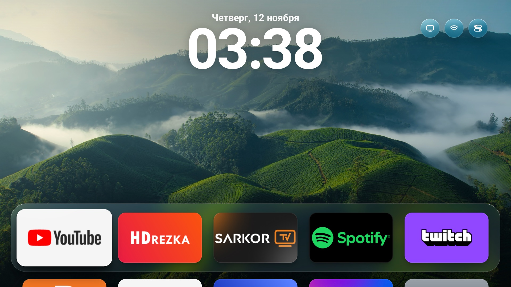

Лаунчер для телевизоров на Android TV / Google TV, который выглядит и ведёт себя как tvOS 26 на Apple TV:
«жидкое стекло», крупные баннеры приложений с наклоном и бликом, Пункт управления, переключатель приложений,
настройки в стиле tvOS и заставка из настоящих видео Apple TV Aerial. Нативное приложение Android (без WebView и
библиотек): ровные 60 кадров в секунду и ~95 МБ памяти даже на ТВ с 2 ГБ.

*English: an Apple TV (tvOS 26) style home screen for Android TV / Google TV, written as a native Android app
(plain Views, no WebView, no libraries). Liquid-glass UI, Control Center, app switcher, tvOS-like Settings, Apple's
Aerial screen saver. Install it with Claude Code: open this repository and ask it to follow [CLAUDE.md](CLAUDE.md).*

## Что умеет

- **Главный экран**: ваши приложения с их баннерами, 5 в ряд, док на стеклянной подложке; часы и дата над ним.
  Долгое нажатие OK — меню значка: переместить, скрыть, настройки приложения.
- **Пункт управления** (кнопка «Меню» на пульте или значок сверху): режим сна, сеть, источник (HDMI/антенна),
  таймер сна, яркость интерфейса, фоны, заставка, светлое/тёмное оформление.
- **Переключатель приложений**: «Домой» дважды. Карточки недавних приложений, ↑ — закрыть приложение.
- **Настройки как в tvOS**: 11 разделов, настоящие данные телевизора (модель, память, хранилище, сеть, отключённые
  пакеты), а экраны Android (Wi-Fi, Bluetooth, изображение, звук, приложения) открываются из них одним нажатием.
- **Заставка Apple TV Aerial**: 114 видео прямо с серверов Apple с подписями мест на русском, темы
  «Природа», «Города», «Под водой», «Планета Земля», смена видео каждую минуту (настраивается).
  Без интернета — медленная камера по фонам.
- **Фоны**: снимки из заставки Apple (скачиваются при установке) и встроенные градиенты.
- **Экранная клавиатура tvOS**, алерты, VoiceOver, жирный шрифт, понижение прозрачности, уменьшение движения.
- **Звуки интерфейса** в духе tvOS: три своих набора — «TV OS», «Стекло», «Мягкий» (их рисует
  [tools/sounds.py](tools/sounds.py)) — или системные звуки Android: *Настройки → Видео и аудио → Набор звуков*.
- **Свои баннеры** для любых приложений: `web/assets/icons/<пакет>.png` (640×384) и `names.json` с подписями —
  попадают только в вашу сборку, в git их нет.
- **Быстро на слабых ТВ**: нативная отрисовка, пружинные анимации без лишних кадров, в простое — ноль процессора.
  Плюс советы, как ускорить сам ТВ: [optimization/](optimization/README.md).

## Скриншоты

| | |
|---|---|
| 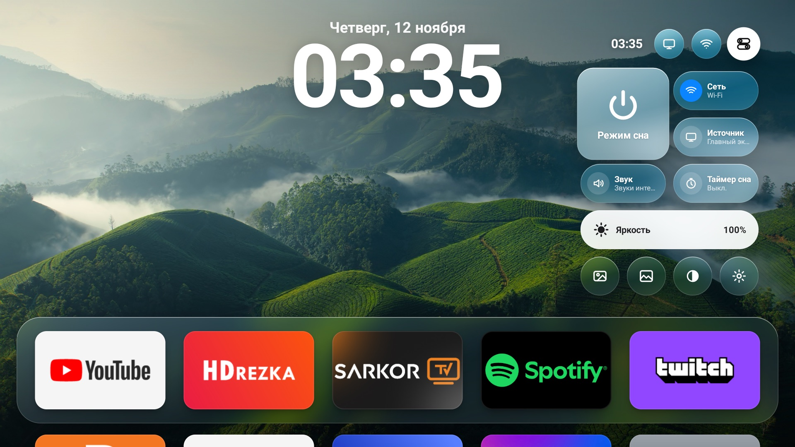 Пункт управления | 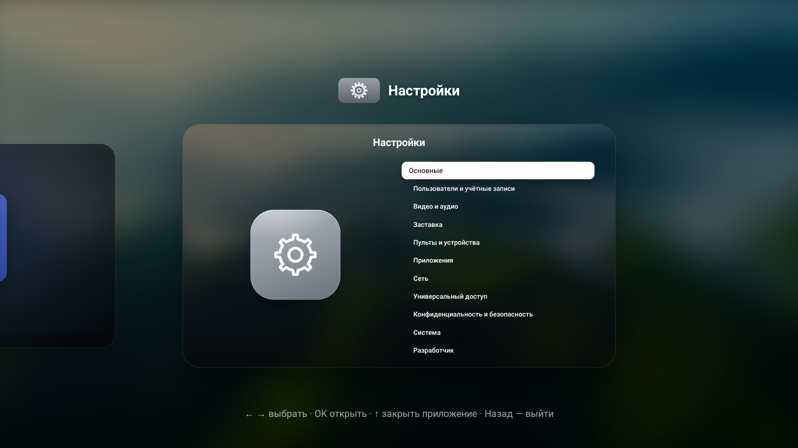 Переключатель приложений |
| 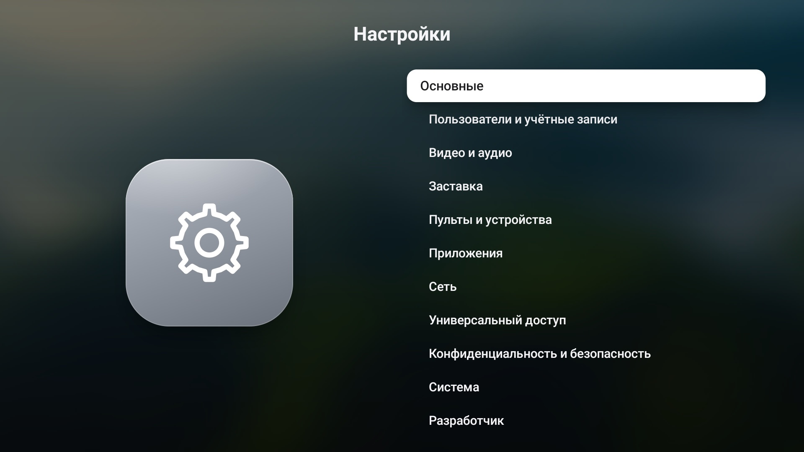 Настройки | 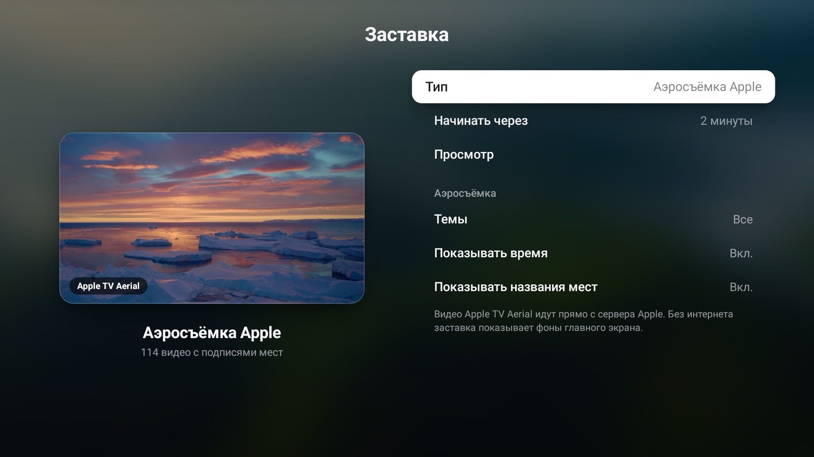 Настройки заставки, тёмное оформление |
| 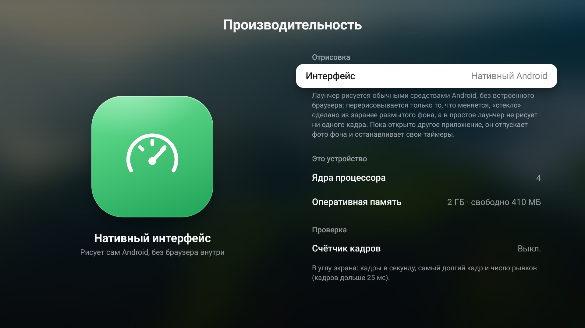 Производительность | 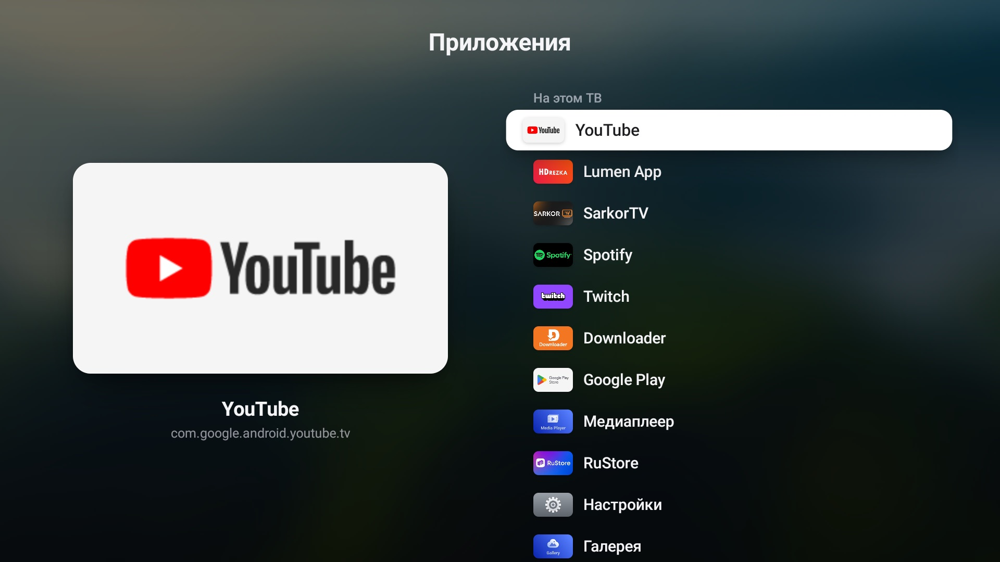 Приложения |
| 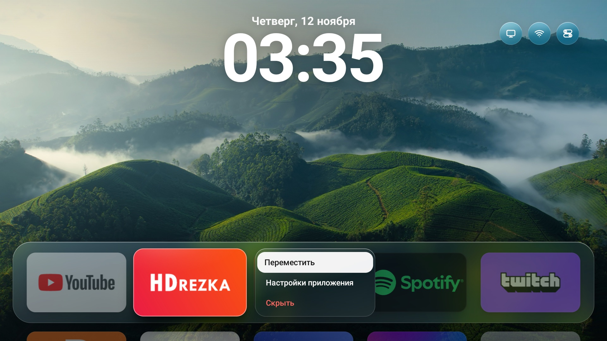 Меню значка | 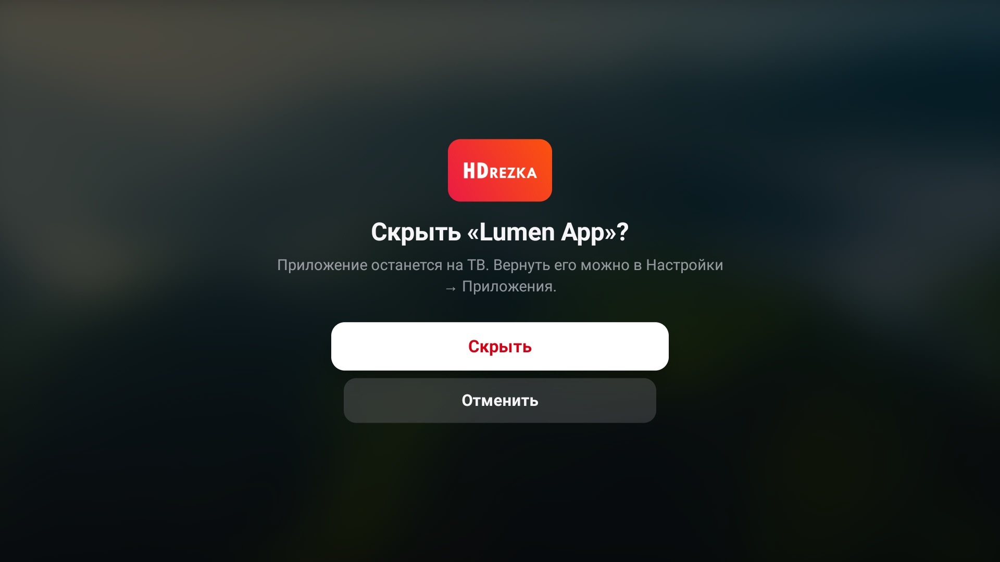 Алерт |
| 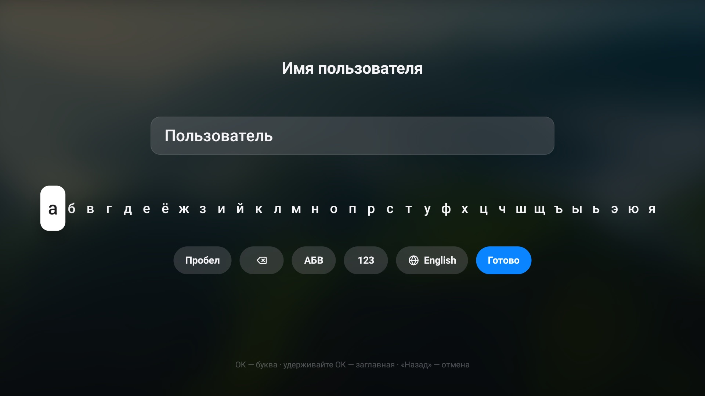 Клавиатура | 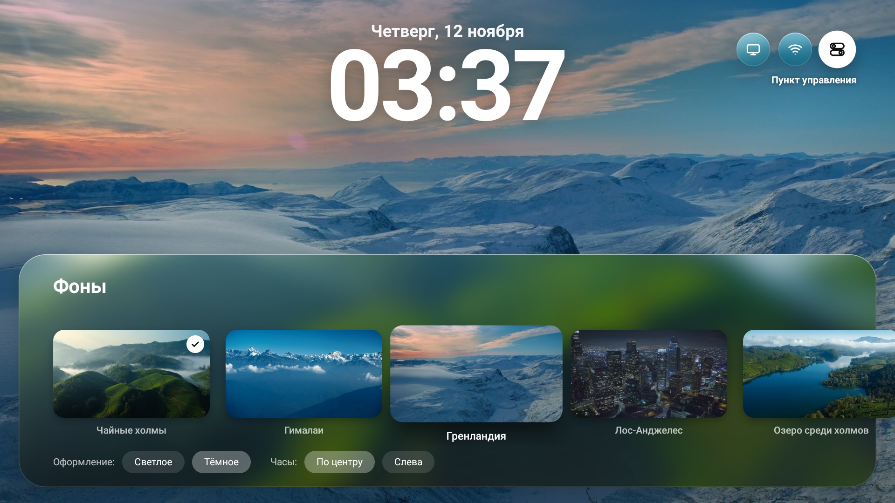 Фоны |
| 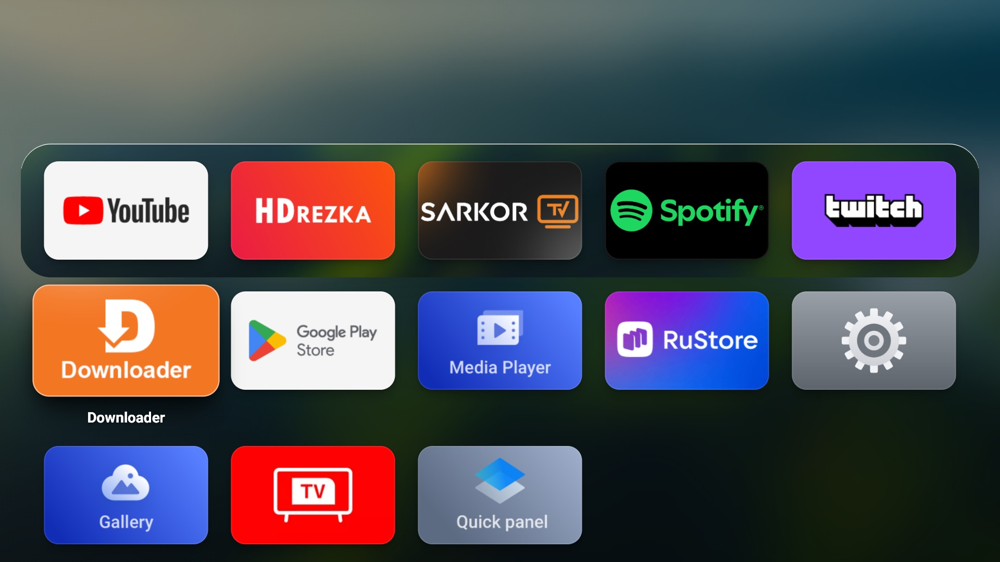 Все приложения | |

Скриншоты сняты прямо с телевизора (TCL на Google TV). Фоны на них — кадры Apple TV Aerial: в репозиторий они не
входят, `tools/aerials.py` скачивает их с серверов Apple при установке. Приложения на ТВ будут ваши.

## Установка через Claude Code

Самый простой путь. Откройте [Claude Code](https://claude.com/claude-code) в папке с этим репозиторием и напишите:

> Установи этот лаунчер на мой телевизор. Следуй CLAUDE.md.

Claude проверит, что всё нужное есть на компьютере, подключится к ТВ по сети, соберёт приложение и поставит его,
спрашивая разрешения перед каждым изменением на телевизоре. Инструкция для него — [CLAUDE.md](CLAUDE.md).

## Установка вручную

### Что нужно

- Компьютер с macOS или Linux: `adb`, JDK 17 и Android SDK (проще всего поставить Android Studio).
- Телевизор на Android TV / Google TV 7.0 или новее, в одной сети с компьютером.
- На ТВ включить отладку: *Настройки → Система → Об устройстве* — 7 раз нажать на «Сборка ОС», затем
  *Для разработчиков → Отладка по USB* (на многих ТВ это и отладка по сети). IP телевизора — в настройках сети.

### Команды

```bash
git clone https://github.com/bilolisroilovv/tv-os.git && cd tv-os
python3 -I tools/aerials.py          # видео и фоны Apple для заставки (по желанию, ~10 МБ)
tools/build.sh                       # собрать приложение
TV=192.168.1.50 tools/tv.sh connect 192.168.1.50   # на ТВ нажать «Разрешить»
TV=192.168.1.50 tools/tv.sh install
TV=192.168.1.50 tools/tv.sh home     # сделать главным экраном
```

### Как вернуть всё обратно

```bash
TV=192.168.1.50 tools/tv.sh restore     # вернуть прежний главный экран
TV=192.168.1.50 tools/tv.sh uninstall   # и удалить лаунчер
```

Лаунчер ничего не удаляет и не отключает на ТВ; прежний главный экран остаётся установленным.

## Посмотреть в браузере

Дизайн удобно смотреть и менять в браузерном прототипе `web/` (с него сделано нативное приложение):

```bash
python3 -I tools/serve.py   # затем открыть http://localhost:8765
```

Стрелки — пульт, Enter — OK (удерживать — меню), Esc — «Назад», H — «Домой» (дважды — переключатель),
C — Пункт управления, G — Настройки, S — заставка, W — фоны, M — звук.

## Как это устроено

```
android/        нативное приложение (Java, обычные View Android, без библиотек)
  .../home/     Home — главный экран, Control — Пункт управления, Settings, Switcher, Saver (заставка),
                Modal (алерты и клавиатура), Motion (пружины), Gfx (стекло, тени), Sounds, Device (данные ТВ)
web/            браузерный прототип и эталон дизайна (HTML/CSS/JS)
tools/          сборка, установка на ТВ, замеры, звуки, видео и фоны Apple, скриншоты прототипа
optimization/   как ускорить сам телевизор
```

Всё рисуется на «сцене» 1920×1080 в пикселях прототипа: на ТВ Full HD один к одному. Фото и каталог видео Apple,
которые делает `tools/aerials.py`, упаковываются в APK при сборке.

### Производительность

- Анимации — настоящие пружины на одном таймере кадров (Choreographer). Двигаются свойства RenderNode
  (сдвиг, масштаб, наклон, прозрачность): видеочип только переставляет уже нарисованное. Когда ничего не движется,
  кадры не рисуются вовсе.
- «Стекло» — заранее размытая копия фона под тонировкой, одним проходом шейдера (на Android 11 живого размытия нет).
- Тени значков нарисованы один раз: все слои тени одной картинкой, без места под самим значком.
- Фото с затемнением под часами «запекается» в одну картинку и хранится только в памяти видеочипа.
- Всё скрытое не рисуется: под Настройками, заставкой, алертом и переключателем главный экран выключен.
- Пункт управления собран заранее и вылетает из кнопки одним слоем.
- Пока открыто другое приложение: ни таймеров, ни часов, фото (8 МБ) отпущено, память видеочипа освобождена.

Замеры на TCL с 2 ГБ (Realtek RTD2851A, видеочип Mali-G31), WebView-версия и нативная (к/с — кадров в секунду):

| | WebView | Нативная |
|---|---|---|
| Перемещение по значкам, к/с | 53 | **60** |
| Переход между рядами, к/с | 52 | **60** |
| Пункт управления, к/с | 43, первое открытие замирает до 0,8 с | **60** |
| Настройки, к/с | 52 | **59** |
| Переключатель приложений, к/с | 49 | **55** (все кадры быстрее 12 мс) |
| Память на главном экране | ~300 МБ | **~95 МБ** |
| Память, пока открыт YouTube | 184 МБ | **87 МБ** |
| Процессор в простое | 0–3 % | **0 %** |

Свои замеры: `TV=<ip> tools/bench.sh` (два раза подряд: в первый раз Android ещё компилирует код), счётчик кадров —
*Настройки → Система → Производительность*.

## Ограничения

- «Режим сна» гасит изображение, но не выключает подсветку: выключить ТВ может только система.
- «Яркость интерфейса» приглушает лаунчер, а не подсветку; подсветка — в «Изображение и яркость ТВ».
- Сети Wi-Fi и Bluetooth настраиваются в экранах Android (лаунчер открывает их сам).
- Переключение входов HDMI зависит от прошивки ТВ.
- Приложение подписано ключом того компьютера, где его собрали. Обновлять его нужно с того же компьютера
  (или сначала удалить).

## Права

Код — MIT ([LICENSE](LICENSE)). Проект не связан с Apple. «Apple TV», «tvOS» и «Aerial» — товарные знаки Apple;
видео и снимки Aerial принадлежат Apple и в репозиторий не входят: лаунчер показывает их прямо с серверов Apple,
а `tools/aerials.py` скачивает каталог и снимки на ваш компьютер. Баннеры приложений берутся из самих приложений
на вашем ТВ.
