# TV OS — главный экран в стиле Apple TV для Android TV и Google TV

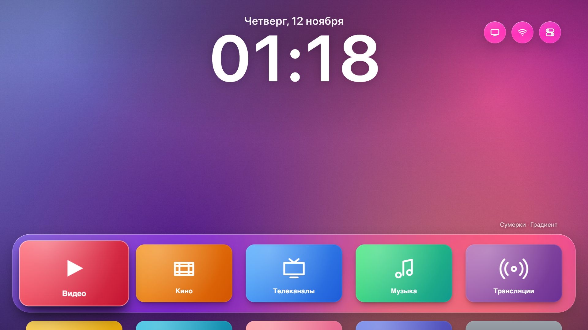

Лаунчер для телевизоров на Android TV / Google TV, который выглядит и ведёт себя как tvOS 26 на Apple TV:
«жидкое стекло», крупные баннеры приложений с наклоном и бликом, Пункт управления, переключатель приложений,
настройки в стиле tvOS и заставка из настоящих видео Apple TV Aerial. Работает быстро даже на ТВ с 2 ГБ памяти.

*English: an Apple TV (tvOS 26) style home screen for Android TV / Google TV. Liquid-glass UI, Control Center,
app switcher, tvOS-like Settings, Apple's Aerial screen saver, a fast mode for weak TVs. Install it with Claude
Code: open this repository and ask it to follow [CLAUDE.md](CLAUDE.md).*

## Что умеет

- **Главный экран**: ваши приложения с их баннерами, 5 в ряд, док на стеклянной подложке; часы и дата над ним.
  Долгое нажатие OK — меню значка: переместить, скрыть, настройки приложения.
- **Пункт управления** (кнопка «Меню» на пульте или значок сверху): режим сна, сеть, источник (HDMI/антенна),
  таймер сна, яркость интерфейса, фоны, заставка, светлое/тёмное оформление.
- **Переключатель приложений**: «Домой» дважды. Карточки недавних приложений, ↑ — закрыть приложение.
- **Настройки как в tvOS**: 11 разделов, настоящие данные телевизора (модель, память, хранилище, сеть, отключённые
  пакеты), а экраны Android (Wi-Fi, Bluetooth, изображение, звук, приложения) открываются из них одним нажатием.
- **Заставка Apple TV Aerial**: 114 видео прямо с серверов Apple с подписями мест на русском, темы
  «Природа», «Города», «Под водой», «Планета Земля». Без интернета — медленная камера по фонам.
- **Фоны**: снимки из заставки Apple (скачиваются при установке) и встроенные градиенты.
- **Экранная клавиатура tvOS**, алерты, VoiceOver, жирный шрифт, понижение прозрачности, уменьшение движения.
- **Звуки интерфейса** в духе tvOS; можно подложить свои файлы ([web/assets/sounds](web/assets/sounds/README.md)).
- **Быстрый режим** для слабых ТВ (включается сам): без живого размытия и тяжёлых эффектов, «стекло» из заранее
  размытого фона, анимации только сдвигом и прозрачностью. Плюс советы, как ускорить сам ТВ: [optimization/](optimization/README.md).

## Скриншоты

| | |
|---|---|
| 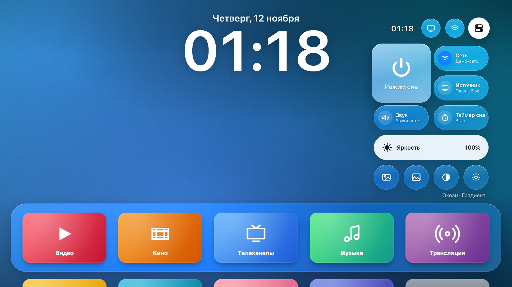 Пункт управления | 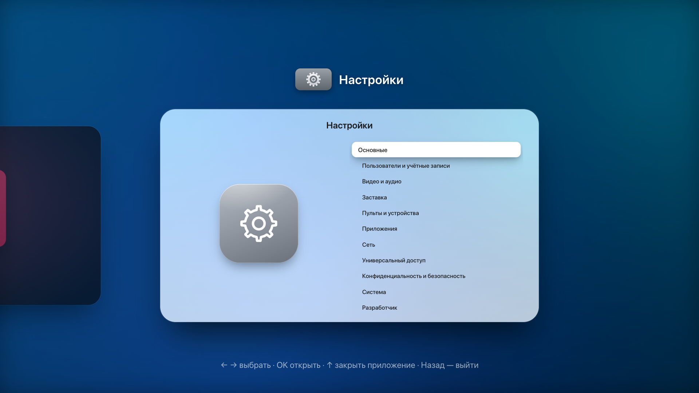 Переключатель приложений |
| 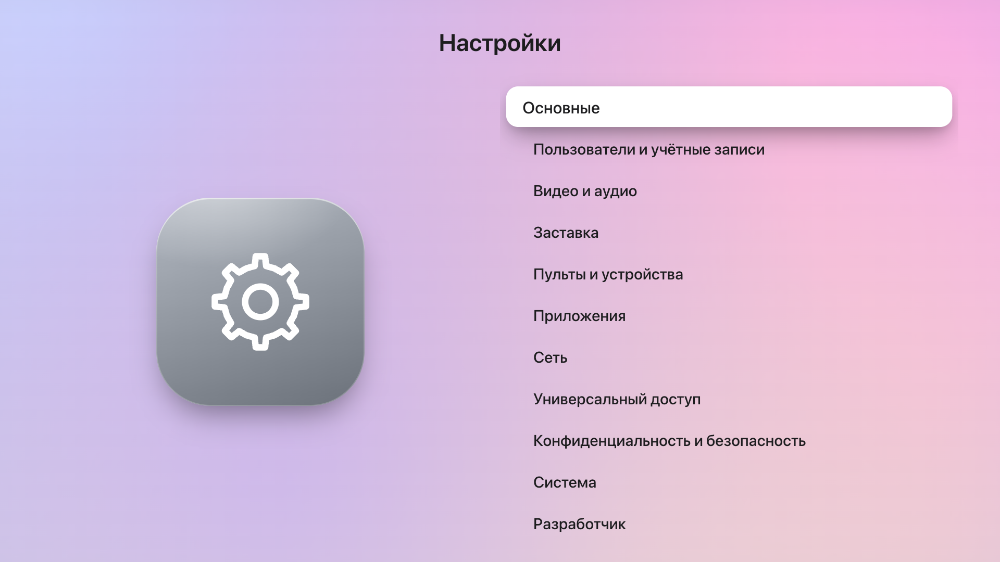 Настройки | 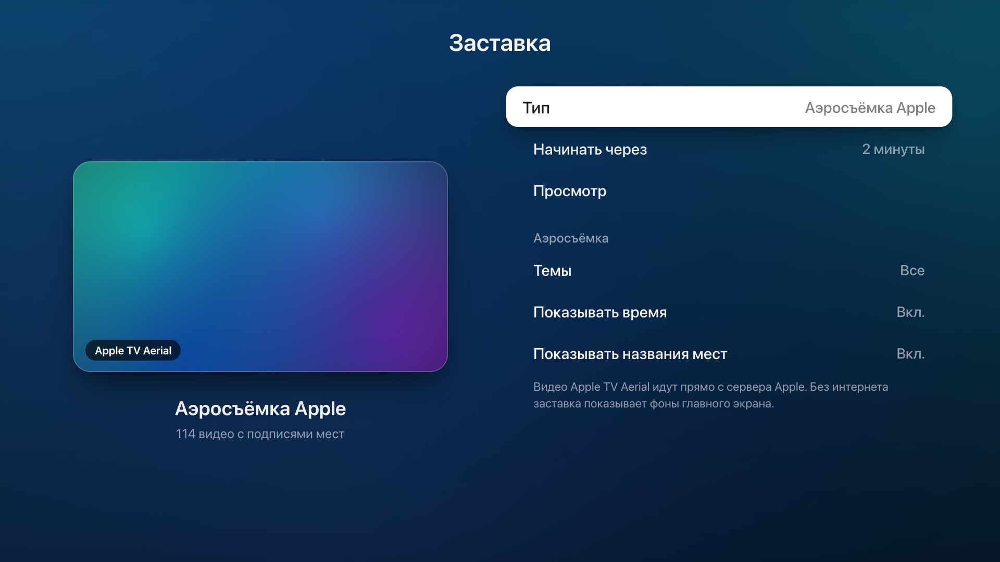 Настройки заставки, тёмное оформление |
| 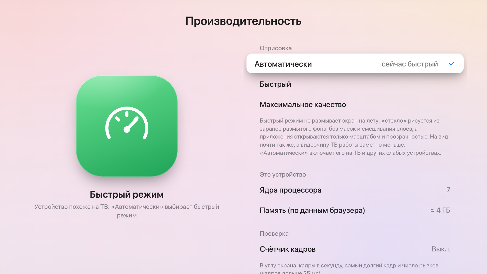 Производительность | 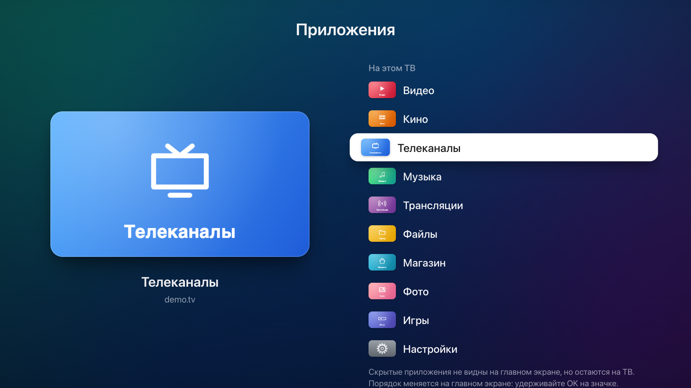 Приложения |
| 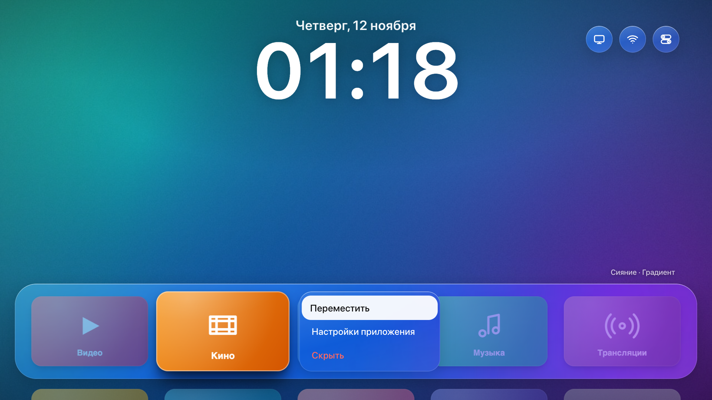 Меню значка | 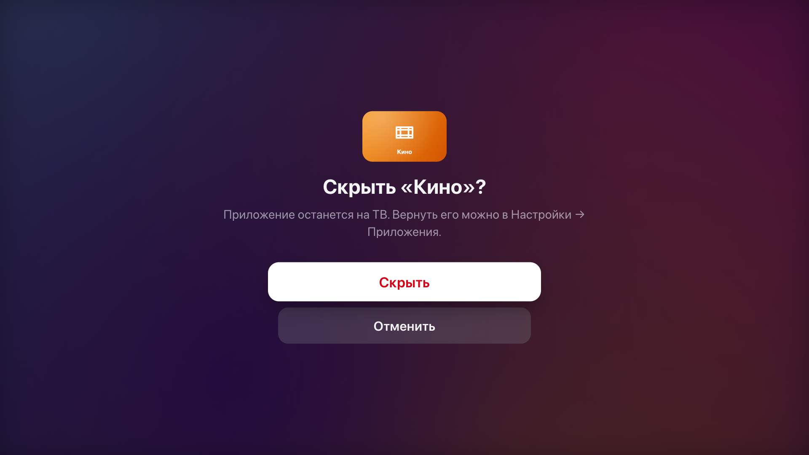 Алерт |
| 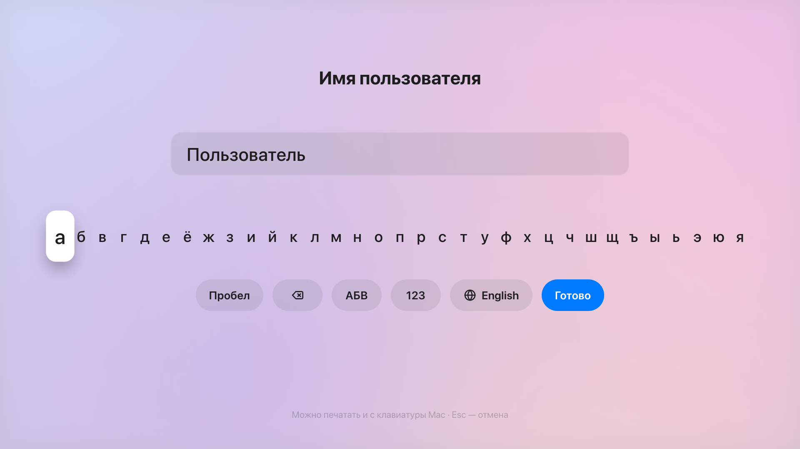 Клавиатура | 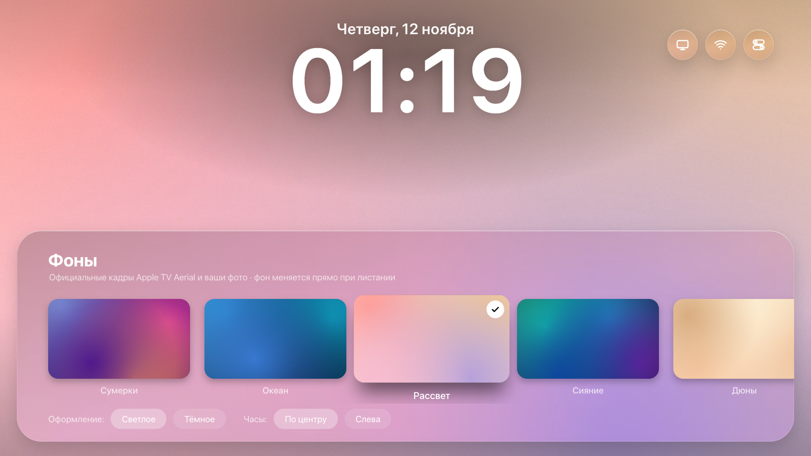 Фоны |
| 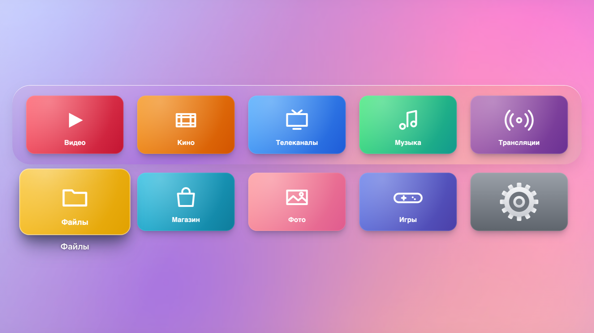 Все приложения | |

На скриншотах демо-приложения: в браузере лаунчер показывает их вместо настоящих. На телевизоре будут ваши.

## Установка через Claude Code

Самый простой путь. Откройте [Claude Code](https://claude.com/claude-code) в папке с этим репозиторием и напишите:

> Установи этот лаунчер на мой телевизор. Следуй CLAUDE.md.

Claude проверит, что всё нужное есть на компьютере, подключится к ТВ по сети, соберёт приложение и поставит его,
спрашивая разрешения перед каждым изменением на телевизоре. Инструкция для него — [CLAUDE.md](CLAUDE.md).

## Установка вручную

### Что нужно

- Компьютер с macOS или Linux: `adb`, JDK 17 и Android SDK (проще всего поставить Android Studio).
- Телевизор на Android TV / Google TV 7.0 или новее, в одной сети с компьютером.
- На ТВ включить отладку: *Настройки → Система → Об устройстве* — 7 раз нажать на «Сборка ОС», затем
  *Для разработчиков → Отладка по USB* (на многих ТВ это и отладка по сети). IP телевизора — в настройках сети.

### Команды

```bash
git clone https://github.com/bilolisroilovv/tv-os.git && cd tv-os
python3 -I tools/aerials.py          # видео и фоны Apple для заставки (по желанию, ~10 МБ)
tools/build.sh                       # собрать приложение
TV=192.168.1.50 tools/tv.sh connect 192.168.1.50   # на ТВ нажать «Разрешить»
TV=192.168.1.50 tools/tv.sh install
TV=192.168.1.50 tools/tv.sh home     # сделать главным экраном
```

### Как вернуть всё обратно

```bash
TV=192.168.1.50 tools/tv.sh restore     # вернуть прежний главный экран
TV=192.168.1.50 tools/tv.sh uninstall   # и удалить лаунчер
```

Лаунчер ничего не удаляет и не отключает на ТВ; прежний главный экран остаётся установленным.

## Посмотреть в браузере

```bash
python3 -I tools/serve.py   # затем открыть http://localhost:8765
```

Стрелки — пульт, Enter — OK (удерживать — меню), Esc — «Назад», H — «Домой» (дважды — переключатель),
C — Пункт управления, G — Настройки, S — заставка, W — фоны, M — звук.

## Как это устроено

```
web/            сам лаунчер: HTML/CSS/JS, работает и в браузере, и на ТВ
  core/         экран 1920×1080, пульт, звуки, пружинные анимации
  os/           системный слой: Настройки, алерты, клавиатура, переключатель, платформа (мост к Android)
  data/         фоны; видео Apple (data/aerials.js делает tools/aerials.py)
android/        приложение Android: полноэкранный WebView + мост к системе (приложения, сеть, входы, настройки)
tools/          сборка, установка на ТВ, видео и фоны Apple, скриншоты, локальный сервер
optimization/   как ускорить сам телевизор
```

На ТВ страница грузится из APK через собственный адрес `https://tvos.local/`; мост `window.Android` отдаёт список
приложений с баннерами, данные устройства и сети, входы ТВ и открывает экраны настроек Android. Кнопки пульта,
которые веб-страница не видит («Назад», «Домой», «Меню»), приложение передаёт лаунчеру само.

### Производительность

- Фоны и их размытые копии готовятся заранее, в маленьком размере; полноразмерное фото декодируется только одно.
- В быстром режиме нет ни одного `backdrop-filter`, маски или режима смешивания: всё это заставляет видеочип
  перерисовывать экран каждый кадр.
- Тени фокуса и подсветка строк не перерисовываются, а только проявляются (прозрачность).
- Приложения и Настройки открываются масштабом и прозрачностью — это анимирует компоновщик, без перерисовки.
- Скрытые слои отпускают картинки, спрятанные панели не рисуются, звуки готовятся в простое.
- Счётчик кадров: *Настройки → Система → Производительность*.

## Ограничения

- «Режим сна» гасит изображение, но не выключает подсветку: выключить ТВ может только система.
- «Яркость интерфейса» приглушает лаунчер, а не подсветку; подсветка — в «Изображение и яркость ТВ».
- Сети Wi-Fi и Bluetooth настраиваются в экранах Android (лаунчер открывает их сам).
- Переключение входов HDMI зависит от прошивки ТВ.
- Приложение подписано ключом того компьютера, где его собрали. Обновлять его нужно с того же компьютера
  (или сначала удалить).

## Права

Код — MIT ([LICENSE](LICENSE)). Проект не связан с Apple. «Apple TV», «tvOS» и «Aerial» — товарные знаки Apple;
видео и снимки Aerial принадлежат Apple и в репозиторий не входят: лаунчер показывает их прямо с серверов Apple,
а `tools/aerials.py` скачивает каталог и снимки на ваш компьютер. Баннеры приложений берутся из самих приложений
на вашем ТВ.
